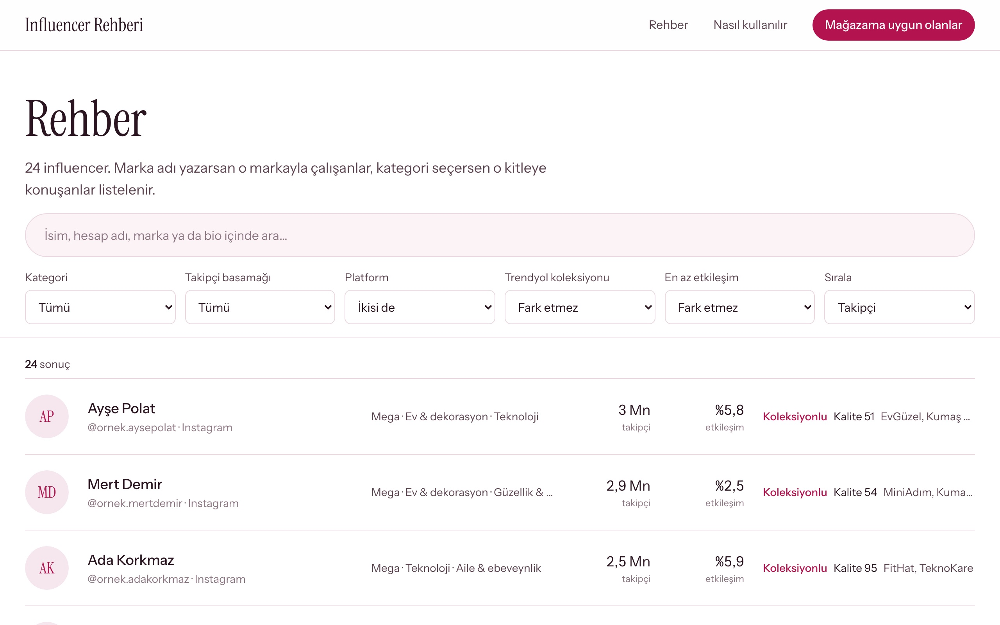
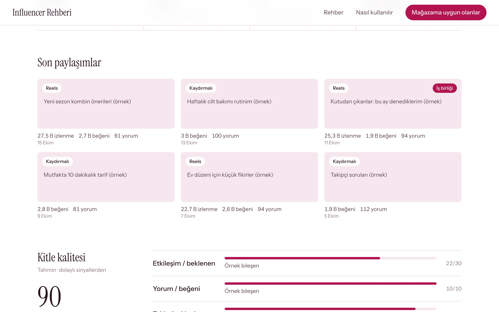
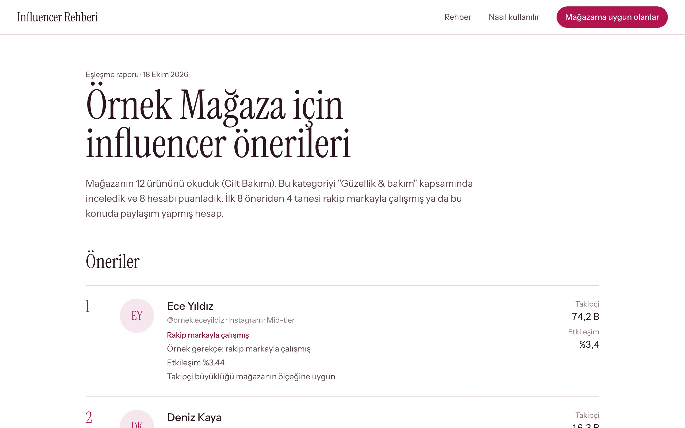

# Influencer Rehberi

[](https://github.com/aytacvelipamuk/influencer-rehberi/actions/workflows/ci.yml)
[](LICENSE)
[](https://influencer.aytacvelipamuk.com)


Trendyol satıcılarının ürününü anlatacak influencer'ı bulması için **ücretsiz ve açık kaynak** bir rehber.
Influencer'ları kategori, takipçi büyüklüğü, etkileşim, kitle kalitesi ve çalıştıkları markalarla arar; mağaza linkinden
eşleşme raporu üretir.

Canlı örnek: **https://influencer.aytacvelipamuk.com**

[English below](#english)

| Giriş | Rehber |
|---|---|
|  |  |
| **Profil analizi** | **Eşleşme raporu** |
|  |  |

*Görüntülerdeki hesaplar uydurmadır (örnek veri).*

---

## Neler var

| Parça | Ne yapar |
|---|---|
| **Rehber** (`/rehber`) | Arama (isim, hesap, marka, bio), kategori / basamak / platform / etkileşim filtreleri, sıralama |
| **Profil** (`/i/instagram/<hesap>`) | Son paylaşımlar (görselli), öne çıkan hikâyeler, kitle kalitesi puanı, paylaşım ritmi, içerik türü, iş birlikleri, takipçi seyri |
| **Eşleşme raporu** (`/eslestir`, `/rapor/<jeton>`) | Satıcının mağaza linkini ve e-postasını alır; rapor sayfası öneriyi gerekçeleriyle gösterir |
| **Yöntem kütüphanesi** (`lib/scoring`) | Etkileşim oranı, takipçi basamağı, yorum gerçekliği ve **kitle kalitesi puanı** — saf TypeScript, testli, kendi projenize alınabilir |
| **Toplayıcı** (`npm run topla`) | Bright Data anahtarınızla Instagram profillerini, gönderilerini ve Reels'i; TikTok profillerini ve videolarını toplar, siteyi doldurur |
| **Yayın ucu** (`/api/yayin/*`) | Verinizi başka makinede topluyorsanız jetonla siteye yükleyin |

## 1. Hemen çalıştır (örnek veriyle, 2 dakika)

```bash
git clone https://github.com/aytacvelipamuk/influencer-rehberi
cd influencer-rehberi
npm install
npm run dev            # http://localhost:3000
```

`data/` klasörü yoksa site `ornek-veri/` içindeki **uydurma** 24 hesapla açılır (gerçek kişi yoktur).

## 2. Kendi verini topla (Bright Data)

1. [Bright Data](https://brightdata.com) hesabı aç, API anahtarı al.
2. `.env.example` dosyasını `.env` olarak kopyala, `BRIGHTDATA_API_KEY` yaz.
3. `hesaplar.ornek.csv` dosyasını `hesaplar.csv` olarak kopyala, hesapları yaz (satır başına bir hesap; TikTok için `tiktok:@hesap`).
4. Maliyeti gör, sonra topla:

```bash
npm run topla -- --kuru     # yalnız tahmin: "120 hesap · ~2280 kayıt · ~$3.42"
npm run topla               # topla → data/influencers.json + görseller
npm run dev                 # site artık senin verinle açılır
```

- Hesap başına varsayılan: 1 profil + 12 gönderi + 6 Reels ≈ 19 kayıt ≈ **$0,03** (Ekim 2026 fiyatı, kayıt başı ~$0,0015).
- Tahmin `TOPLA_BUTCE_UYARI_USD` (varsayılan $5) üstündeyse `--onay` ister.
- Ağ koparsa ya da işlem yarıda kalırsa: `npm run topla -- --devam` — parası ödenmiş iş yeniden ödenmeden alınır.
- Tekrar çalıştırınca hesaplar güncellenir, takipçi geçmişi birikir (kitle kalitesinin "sıçrama" sinyali buradan gelir).

`hesaplar.csv` biçimi: `hesap[,kategori1;kategori2][,marka1;marka2]` — ayrıntı `hesaplar.ornek.csv` içinde.

**TikTok:** `tiktok:@hesap` ya da `https://www.tiktok.com/@hesap` yaz. TikTok hesabı başına 1 profil + `--gonderi` kadar video
toplanır (izlenme, beğeni, yorum, kapak). TikTok veri setlerinin kayıt fiyatı Instagram'dan farklı olabilir; önce `--kuru`
ile tahmine, sonra birkaç hesaplık denemeye bakın.

## 3. Kendi projene bağla

- **Yalnız yöntemi kullan:** `lib/scoring` saf fonksiyonlardır, bağımlılığı yoktur.
  ```ts
  import { engagementRate, tier, score, engagementComponent, followingComponent, consistencyComponent } from "./lib/scoring";
  const er = engagementRate(posts, followers);           // son gönderilerin medyanı, %
  const kalite = score([engagementComponent(er, followers), followingComponent(following, followers), consistencyComponent(likes)]);
  ```
- **Kendi veri hattını kullan:** `data/influencers.json` dosyasını [veri sözleşmesine](docs/VERI-SOZLESMESI.md) uygun yaz, site okur.
- **Uzaktan besle:** veriyi başka makinede üretiyorsan [yayın ucu](docs/KURULUM.md#yayın-ucu) ile yükle.

## Yöntem

Etkileşim, takipçi basamağı ve kitle kalitesinin nasıl hesaplandığı: [docs/YONTEM.md](docs/YONTEM.md).
Kısaca: kitle kalitesi, takipçi listesine erişmeden yedi dolaylı sinyalden kurulan **bir tahmindir**; verisi olmayan sinyal
puana girmez, üçten az sinyalde puan verilmez. Influencer ücreti bilerek gösterilmez.

## Neler yok ve neden

- **Gerçek veri ve kişi verisi:** repoda yok. Topladığınız veri sizin sorumluluğunuzdadır (KVKK/GDPR; site bir kaldırma
  formu ve aydınlatma metni şablonuyla gelir — kendi hukukçunuza kontrol ettirin).
- **Trendyol'dan veri okuyan kod:** yok. Platformların kullanım şartlarına saygı için toplama yalnız Bright Data'nın resmî
  API'si üzerindendir.
- **Instagram hikâyeleri (24 saatlik):** toplanmaz — giriş yapmadan okunamaz. Profilde sabitlenmiş "öne çıkan hikâye"
  kapakları ve başlıkları gösterilir.
- **Eşleşme raporunu üreten ve e-postayla gönderen hat:** bu sürümde yok; form talepleri `talepler/eslestir.jsonl`
  dosyasına yazılır, `/api/yayin/talepler` ucundan çekilir. Rapor JSON'u [sözleşmeye](docs/VERI-SOZLESMESI.md#rapor) uygun
  üretilip `/api/yayin/rapor/<jeton>` ile yüklenince `/rapor/<jeton>` sayfası gösterir.

## Kurulum, Docker, yayın

[docs/KURULUM.md](docs/KURULUM.md): yerel, Docker, Coolify; ortam değişkenleri; yayın ucu.

## Katkı

Hata, öneri, yeni kategori sözlüğü, başka pazaryeri uyarlaması: issue ve PR'lar açık. [CONTRIBUTING.md](CONTRIBUTING.md)

## Lisans ve teşekkür

MIT — [LICENSE](LICENSE). Geliştiren: [Aytaç Velipamuk](https://aytacvelipamuk.com).

- Web efekt adları ve zamanlamaları: [motion-prompt](https://github.com/showheyohtaki/motion-prompt) (MIT, Shohei Ohtaki) — ilgili satırlarda lisans notu var.
- Fontlar: Instrument Serif / Instrument Sans (SIL Open Font License).
- Hero videosu: projeyle birlikte yapay zekâyla üretildi (logo ve yazı içermez); kendi videonuzu `NEXT_PUBLIC_HERO_VIDEO` ile verin.
- Bu proje Trendyol, Instagram, Meta ya da Bright Data ile bağlantılı değildir.

---

## English

**Influencer Rehberi** ("influencer directory") is a free, open-source tool that helps e-commerce sellers — built for
Trendyol, Türkiye's largest marketplace — find the right creators for their products. The UI is in Turkish; the code,
method and data contract are documented below and in `docs/`.

**What you get**

- **Directory** — search by name, handle, brand or bio; filter by category, follower tier (nano → mega), platform and
  engagement; sort by followers, engagement or brand experience.
- **Profile analysis** — recent posts and Reels (with images), pinned story highlights, posting rhythm, content mix,
  collaborations, follower history and an **audience-quality estimate** (0–100) built from seven public signals
  (engagement vs. follower-band expectation, comment authenticity, comment/like ratio, following ratio, follower spikes,
  like distribution, Reels views). No score is given from fewer than three signals.
- **Match report** — a seller pastes their store link; the report page ranks creators with reasons.
- **Scoring library** (`lib/scoring`) — dependency-free TypeScript, unit-tested; use it in your own project.
- **Collector** (`npm run topla`) — bring your own [Bright Data](https://brightdata.com) API key and a list of Instagram
  (or `tiktok:@handle`) accounts; it collects profiles, posts and Reels (TikTok: profile + videos) (~$0.03 per account at Oct 2026 prices), shows a cost estimate first
  (`--kuru`), and resumes interrupted jobs without paying twice (`--devam`).

**Quick start**

```bash
git clone https://github.com/aytacvelipamuk/influencer-rehberi && cd influencer-rehberi
npm install && npm run dev                 # runs with synthetic sample data
cp .env.example .env                       # add BRIGHTDATA_API_KEY
cp hesaplar.ornek.csv hesaplar.csv         # one handle per line; tiktok:@handle for TikTok
npm run topla -- --kuru && npm run topla   # estimate, then collect → data/influencers.json
```

Not included on purpose: real or personal data, code that reads Trendyol directly, and 24-hour Instagram stories (they
require a login). Not affiliated with Trendyol, Instagram, Meta or Bright Data. MIT licensed.
